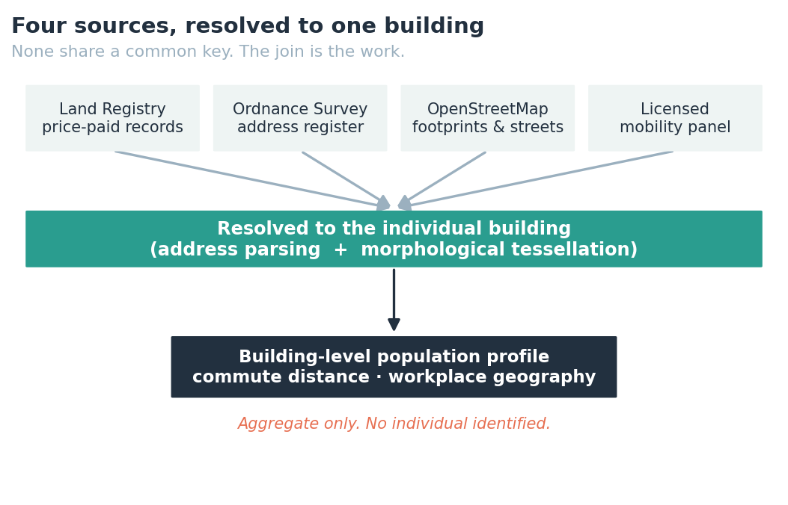
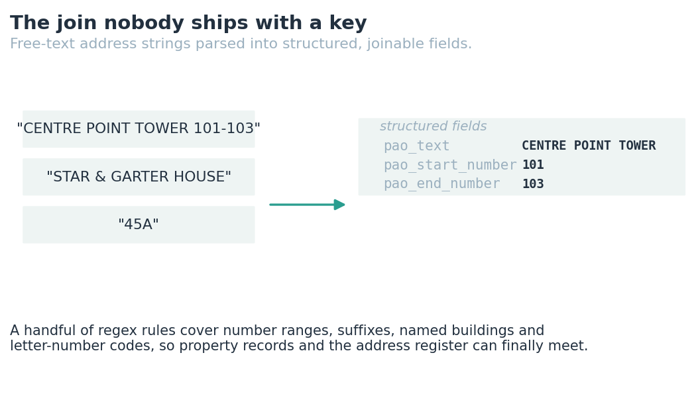

*A decision-science engagement for an institutional real estate investor, through London Data Unit. Anonymised. Built on public data (HM Land Registry price-paid records, Ordnance Survey AddressBase, OpenStreetMap) and a licensed, aggregate mobility panel. No individual is identified anywhere in the method or its output.*

[&larr; Back to portfolio](../)

**Objective:** profile who would live in a planned high-end residential scheme, by finding and clustering the residents of comparable existing buildings, to guide its design and marketing.

*Four datasets that share no common key, resolved to one unit (the individual building) and then to the behavioural archetypes of the people who live in that kind of building.*

## The question behind it

The investor was in the design phase of a large new high-end residential scheme and wanted to answer a question no survey can reach: who will actually live here, and what do they want? You cannot ask the residents of a building that does not exist yet. So the project works backwards: find the residents of comparable existing developments, cluster them into a handful of behavioural archetypes, and profile what each archetype actually does, where they shop, where they work, where they go for leisure, how they move, so the new building can be designed and marketed around real people rather than a demographic guess.

Everything below (joining property records, carving the city into buildings, reducing a mobility panel) exists to serve that one goal: a set of resident archetypes an architect and a marketing team can actually use.

## What this piece demonstrates

- **It starts from the commercial decision.** The deliverable is a characterisation of who the future residents are likely to be and what they value, aimed squarely at design and marketing choices, rather than a map of where people are. The analysis is reverse-engineered from that.
- **Entity resolution is where the accuracy lives.** Property transaction records and the national address register describe the same buildings but share no common key, and both store addresses as free text: "23-33", "45A", "STAR & GARTER HOUSE", "CENTRE POINT TOWER 101-103". A parser pulls each string into structured components so the two can be joined, and a filter on buildings with several separate high-value flat sales isolates the comparable stock. If this step is wrong, every archetype downstream is built on the wrong buildings.
- **The city is carved into buildings, not circles.** A morphological tessellation divides the map into street-bounded cells around each building footprint, so "a resident of this development" means a sensible boundary rather than an arbitrary radius.
- **Movement becomes behaviour, then archetypes.** The mobility panel is reduced to stay points; the places each resident dwells are attributed to points of interest (down to the kind of venue) to build per-resident behavioural features; those features are clustered, with the usual tests for how many clusters the data really supports, into the salient archetypes. The person is always a means to an aggregate; the output is the archetypes and their amenity profiles, never an individual.

## How it fits together

Public property records give high-value flat transactions; the address parser and a join to the national address register turn those into geocoded comparable buildings. Map data supplies footprints and the street network, from which a morphological tessellation produces one street-bounded cell per building. The licensed mobility panel is processed with stay-point detection and attributed to those cells to identify likely residents; their dwell locations are labelled against points of interest to build behavioural features; and those features are clustered into archetypes, each described by the retail, workplace and leisure patterns that define it and by how it is distributed across the geography. Four sources that were never designed to be joined, resolved into a handful of actionable resident types, holding nothing about any individual.

*The parser that makes the join possible: free-text address strings resolved into the structured fields that let property records and the address register meet.*

## Honest limits

This describes the method and its intent, not the archetypes themselves: the client's findings were delivered to them and are not mine to publish, so there are no cluster profiles or numbers here. A mobility panel is a sample, skewed by who carries which apps, and inferred residence and dwell behaviour are probabilistic rather than ground truth. The address resolution is imperfect, so the comparable buildings are a subset. The mobility data is licensed and privacy-constrained; nothing individual is shown or shareable. The value on display is the approach: turning "who will live in our building" into a defensible, aggregate set of archetypes you can design around, from data that was never meant to answer it.

**Methods and tools:** address entity resolution, morphological enclosed tessellation (momepy), mobility stay-point detection (pymove), points-of-interest attribution, behavioural clustering, Python.

---

*Built by Joey Scully. Product and Commercial Analytics consultant. Available for remote interim and contract work.*
