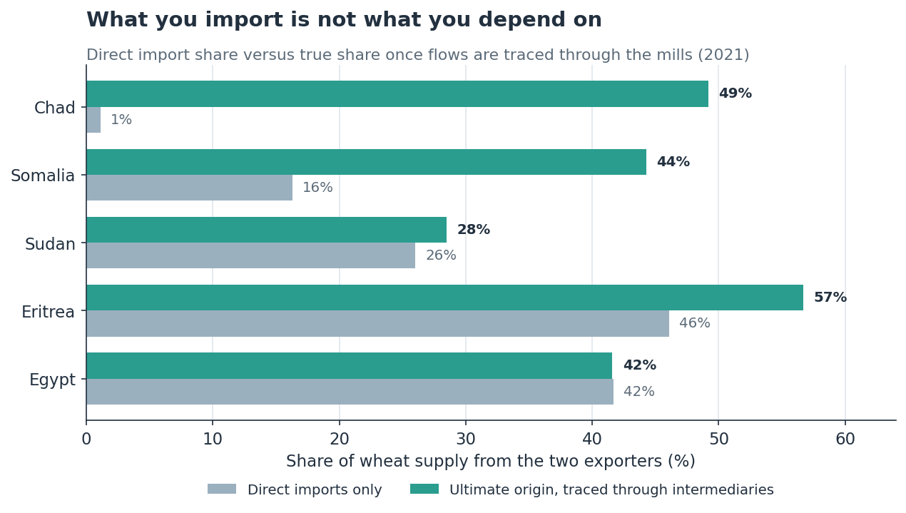
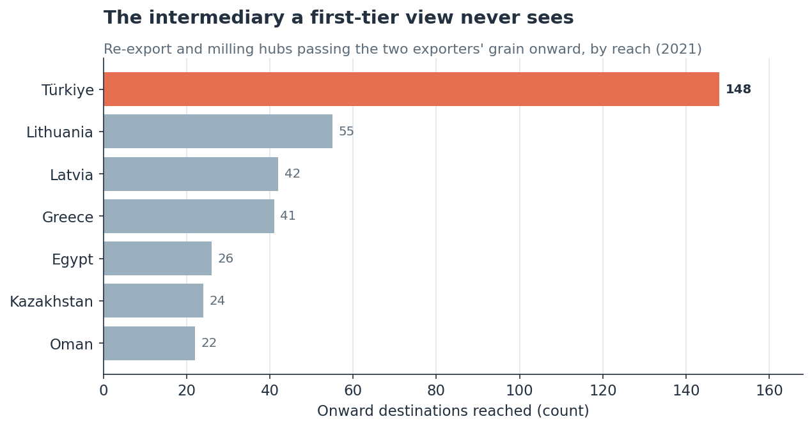

*A self-directed study of concentration risk in trade networks, using the world wheat trade as a worked example. Built on public data: FAOSTAT bilateral trade matrices, food balance sheets and production records.*

[&larr; Back to portfolio](../)

*Direct import share against ultimate-origin share for 2021. Chad buys almost no wheat directly from the two exporters, yet half its supply ultimately comes from them. Egypt mills its own grain, so its two readings agree. Source: FAOSTAT; self-directed analysis.*

## The finding in one line

A country can buy almost none of its wheat directly from the two biggest exporters (Russia and Ukraine) and still get **half of it** from them, because the grain arrives milled into flour or re-exported through a third country. On direct trade data Chad looks **1.1%** exposed; trace the flows through the mills and it is **49%**. That gap is concentration risk that a first-tier supplier view cannot see. The worked example is wheat, but the shape is general: it is the same problem as a supply chain whose tier-one vendors all quietly depend on one tier-three component, or revenue that looks diversified until you notice every channel routes through a single intermediary.

## What this piece demonstrates

- **It reframes exposure as a tracing problem.** Direct import share answers "who do I buy from". Real dependency answers "whose product am I ultimately consuming". The two diverge the moment an intermediary sits in between, a mill turning grain into flour or a port re-exporting it onward. Modelling the entire trade as a directed graph and propagating each shipment back to its origin turns the second, harder question into something you can actually compute.
- **It surfaces the intermediary a first-tier view misses.** One country, Türkiye, passed the two exporters' grain onward to **148 destinations**, far more than any other hub. On a map of direct suppliers it is just another trade partner. In the network it is the single largest chokepoint, and anyone stress-testing their exposure without it would miss the node that matters most.
- **It was built to survive its own assumptions.** The grain-to-flour conversion is an estimate, so I re-ran the whole thing across a range of plausible rates: every fragile state's result moved by less than one percentage point. Five internal consistency checks pass. Countries that do not report their own imports were patched from their suppliers' records and validated against the ones that do (correlation 0.80). The analysis also caught a data-integrity problem on its own: one of the two exporters stopped reporting its trade from 2022, so the snapshot is fixed at 2021 and the reporting gap is reported rather than silently carried.
- **It keeps dependency and risk apart.** A country can source 74% of its wheat from the two exporters and barely be exposed, if wheat is a tiny part of what it eats. DR Congo is 74% dependent, but wheat is 2% of its calories, so the real exposure is near 2%. High concentration on a trivial input is not a real risk. The piece measures both, so the two are never confused.

## How it works

The backbone is FAOSTAT bilateral trade: 175 exporters and 200 importers, 2000 to 2021, covering both wheat grain and wheat flour. Flour is converted to a common wheat-equivalent using a standard extraction rate, so grain and flour can be added up on the same footing. Every flow becomes a weighted edge in a directed graph whose nodes are countries. Each country's supply is then decomposed into ultimate origins by propagating import mix through the graph: if a country re-exports, its outbound wheat is treated as carrying its average inbound origin mix. Countries that do not report their own imports are filled from mirror data, their suppliers' reported shipments to them, which is the only way to see flows from an exporter that has stopped reporting. A caloric overlay from food balance sheets then converts raw dependency into exposure that is weighted by how much the commodity actually matters to each country's diet.

*Intermediaries ranked by onward reach in 2021. One hub dominates: it forwards the two exporters' grain to far more destinations than any other, yet appears as an ordinary trade partner in direct import data. Source: FAOSTAT; self-directed analysis.*

## Honest limits

Proportional mixing is a modelling choice: a country's re-exports are assumed to carry its average inbound origin mix, which blurs where a specific consignment really came from. The data gaps cluster in exactly the fragile states of most interest, which is why the mirror-data patch and its validation matter and are flagged on every patched country. The snapshot is a single year, 2021, chosen because one exporter's reporting stops after it. And dependency is not the whole risk picture: wheat is globally fungible, so a blocked source can often be re-sourced at a price, which this stage deliberately does not model. The value here is the method: a repeatable way to measure the exposure that first-tier numbers hide, and to be honest about how much of it is real.

**Methods and tools:** directed trade-network modelling, ultimate-origin decomposition, graph construction, mirror-data imputation with validation, extraction-rate sensitivity analysis, FAOSTAT and World Bank sources, Python, pandas, NetworkX.

---

*Built by Joey Scully. Product and Commercial Analytics consultant. Available for remote interim and contract work.*
