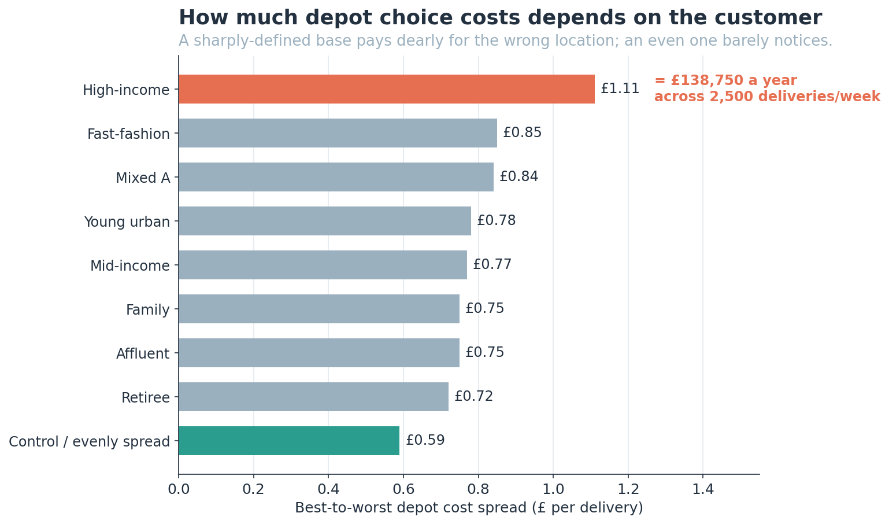
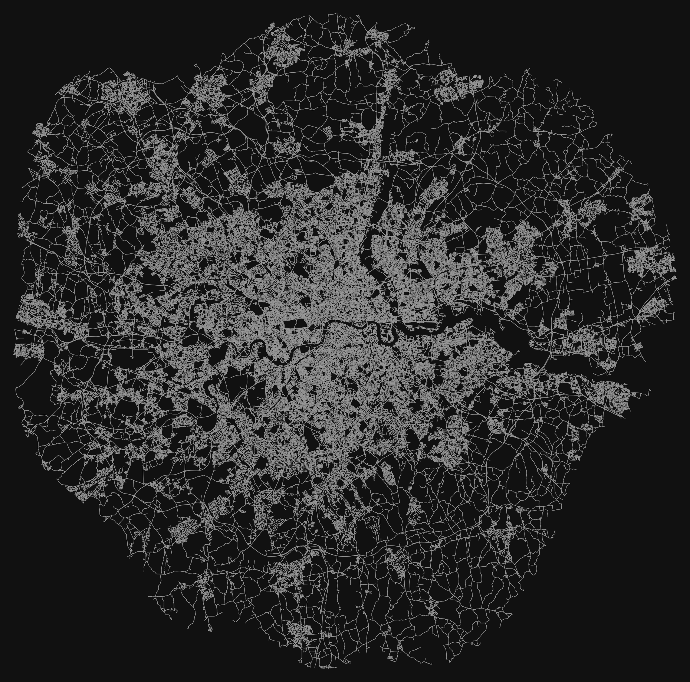

*A decision-science study for Hines, the global real estate investor, through London Data Unit. Published as a research paper (LDU-HINES 001, 2020). Built on public data: ONS Census, OpenStreetMap, OSRM, Ordnance Survey AddressBase.*

[&larr; Back to portfolio](../) · [Read the full 45-page paper (PDF)](../papers/hines001-logistics-location-analysis.pdf)

**Objective:** put a defensible number on the logistics cost hidden inside where a warehouse sits, so it could be priced into an investment decision.

## The finding in one line

For a high-income customer base, picking the wrong London depot out of 23 cost more than **£1 per delivery**. Over 2,500 deliveries a week that is **£138,750 a year**, roughly the annual rent on 7,000 sq ft of industrial space in Acton, hidden inside a rent decision that looked like it was already settled.

*Best-to-worst depot cost spread for each customer archetype. A sharply-defined base (top) pays dearly for the wrong location; an evenly-spread one barely notices.*

## What this piece demonstrates

- **It reframed the question before touching the data.** Hines priced warehouses on floor area and broad location, as if every occupier valued a site equally. The real variable is not the building; it is the match between a depot's location and the geography of that occupier's customers. So the question is not "what is this warehouse worth" but "what is it worth to this occupier, given who they serve."
- **It put a defensible figure on an invisible cost.** The penalty for a bad depot choice never shows up on a rent roll. It shows up in delivery cost, and it is different for every occupier. Quantifying it meant simulating the actual deliveries, not estimating.
- **It separated signal from noise before trusting it.** The customer archetypes were screened with spatial autocorrelation (Local Moran's I / LISA) so that only factors with genuine geographic clustering fed the model, and factors like raw speed limits were deliberately left out as artefacts.

## The finding, with its edges

The cost of mis-selecting a depot is not uniform. For a non-specific, evenly-spread customer base the spread between the best and worst depot was small (£0.59 per delivery): location barely matters. For a sharply-defined high-income archetype it was widest (£1.11 per delivery): location matters enormously. That difference is itself the insight.

The reason is geographic. A delivery operation only pays for the distance it actually drives, and the distance depends on how tightly the customers cluster. An evenly-spread base reaches roughly the same total mileage from almost anywhere, so one depot is much like another and the rent is doing all the work. A base concentrated in a few affluent pockets rewards a depot that sits near those pockets and punishes one that does not, because every van spends the day crossing London rather than working a dense round. The sharper the customer geography, the more a location is worth, or costs.

That has two direct commercial moves. The first is pricing warehouse rent against the transport saving a location offers a specific occupier, so a site that happens to sit near a tenant's customers can be let for what that proximity is actually worth to them. The second is treating price-predictability as a location attribute in its own right: for a speculative investor or a third-party logistics tenant who does not yet know which occupier will take the space, a site whose cost barely moves across customer types is a safer asset than one whose cost swings by a third depending on who rents it. The study tells an investor which locations are safe bets for any tenant and which only suit a particular one.

## Method

A consistent spatial frame of 4,835 small areas (ONS LSOAs) across Greater London gives every customer, depot and route the same geographic units to be measured in. Traffic-aware travel-time matrices were built with the OSRM routing engine over a 12-hour delivery window, so the distances in the model are real road journeys at realistic speeds rather than straight lines.

*The Greater London road network as a routing graph, the substrate the routing engine solves over. Travel-time matrices across it drive the delivery simulation.*

On top of that frame sit twelve geodemographic customer archetypes: six derived by agglomerative hierarchical clustering over income, socio-economic class, age and sex, and six constructed heuristically as controls, including the evenly-spread base that acts as the natural baseline. A vehicle-routing solver on Google OR-Tools then generated 1,932 simulated delivery routes from 23 real London depot locations, and a vehicle-and-labour cost model converted those routes into a cost-per-delivery for every archetype-and-depot pair. Running every archetype against every depot is what exposes the spread: the same depot is cheap for one customer base and expensive for another, and the gap between them is the number that matters. The study rejects its pre-registered null hypothesis: geodemographic archetype and logistics cost are related, and the relationship depends on how specific the customer base is.

## Honest limits

The archetypes are modelled test populations, not one real retailer's order book, so the figures show the size and shape of the effect rather than one company's exact bill. Costs are simulated from a routing and cost model, not measured from operations, which means they capture the relative difference between good and bad locations more reliably than the absolute pound figure. The data is 2020 London, before the full shift in delivery patterns that followed. The value of the method is that it is repeatable and that it quantifies something the industry priced by feel: run it against a real occupier's deliveries and the same machinery returns that occupier's actual exposure.

**Methods and tools:** vehicle-routing simulation, OSRM travel-time matrices, Google OR-Tools solver, geodemographic clustering, spatial autocorrelation (Local Moran's I / LISA), Python.

---

*Built by Joey Scully. Product and Commercial Analytics consultant. Available for remote interim and contract work.*
