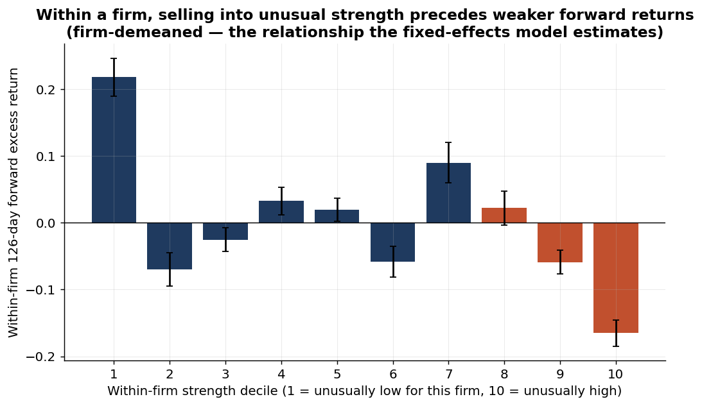

*A study of 9,009 officer stock sales across 48 US companies, and what happened to the share price next.*

[&larr; Back to portfolio](../) · [Code and full writeup on GitHub](https://github.com/yllucsyeoj/insider_buybacks)

**Objective:** test a sharp, falsifiable version of "insiders selling into strength predicts weaker returns", and see whether it survives its own robustness checks.

## The finding in one line

When a company's own officers sell stock after the price has run up hard, the stock tends to lag the market over the next 6 to 12 months. The heaviest "sell-into-strength" cases preceded roughly a **24% shortfall versus the S&P 500 over six months**, after stripping out each company's baseline drift and the broad market.

*Forward six-month excess return by decile of the strength signal, after removing each firm's own average. The relationship is close to monotonic: the harder the insiders sell into strength, the worse the stock does next.*

## What this piece demonstrates

- **A sharp, falsifiable hypothesis**, not a fishing expedition: the signal is specifically in sales made into strength, not insider selling in general. Most insider selling carries no signal at all, because officers sell for reasons that have nothing to do with their view of the company: diversification, a house, a tax bill, a scheduled plan. Isolating the sales made into unusual price strength is what separates the possibly-informative trades from the noise, and stating that boundary up front is what makes the result falsifiable rather than a story fitted after the fact.
- **Robustness decided before looking:** the pattern holds split by time period (pre-2024 versus 2024 and after) and by a random split of the 48 companies into two halves. Neither split was chosen after seeing which one flattered the result. If the effect were an artefact of one era or a few names, one of those splits would break it, and the point of running them was to give it the chance.
- **The judgment call that matters:** a flashier earlier version of this story claimed the signal came from discretionary sales. It was a mirage, two stocks (PLTR, RBLX) wearing a trench coat, 21% of the sales producing 76% of the effect. I killed it. The finding I kept passes exactly the test the flashy one failed.

That last point matters most. The value is not running the regression. It is knowing which result to trust, and being willing to throw away the publishable-looking one that is wrong. The earlier version would have looked better on a slide: a cleaner story, a bigger number, a neat behavioural explanation. It was also an accident of two names in one short window, and a reader acting on it would have been acting on nothing. Finding that out meant deliberately trying to break my own result, which is the opposite of how a finding usually gets treated once it looks good.

## How to read the chart

The chart sorts every sale into ten buckets by how strongly the price had run before it, after subtracting each firm's own average forward return so that a stock which simply drifts up or down over the period cannot create a false pattern. The lowest deciles, sales made into ordinary or weak conditions, sit slightly positive. The top decile, the hardest selling into the strongest run-ups, sits well below the rest. The slope is not perfectly smooth, real financial data never is, but it runs the right way almost all the way down, which is what you want to see before believing a single headline number. A signal that only showed up in the extreme bucket, with noise everywhere else, would be far weaker evidence than a gradient.

## Method

Two-way fixed-effects panel regression (company and calendar-month) of forward excess return on a "strength" measure, with standard errors clustered by company. The two sets of fixed effects do a lot of quiet work: the company effects remove each firm's own long-run drift, and the month effects remove whatever the whole market was doing at that time, so the coefficient is estimated from the within-company, within-month variation that is left. Each company is weighted by its reliability (inverse-variance WLS) so a few volatile names cannot swing the result, and equal-weight OLS is reported alongside as a conservative bound rather than hidden. Data is SEC Form 4 filings, October 2021 to November 2026, and the whole pipeline ships with 84 offline tests so the numbers can be reproduced rather than taken on trust.

Focal 6-month estimate: strength coefficient **−0.239** (*t* = −6.9, *p* < 0.001, *n* = 6,972, 47 firms).

## Honest limits

A historical association checked for robustness, not a prediction made in advance and not a trading strategy: returns are measured versus the market, before costs, and the moment real transaction costs and timing are added the picture changes. 48 large, liquid, mostly-tech names are not the whole market, and delisted companies are underrepresented, which tends to flatter any backward-looking study. The result is clean, falsifiable and reproducible, and that is all it claims to be. The transferable part is not the finding about insiders; it is the habit of writing down the test that would kill a result, running it, and reporting the answer either way.

**Methods and tools:** two-way fixed-effects panel regression, company-clustered standard errors, inverse-variance weighting, decile analysis, out-of-sample robustness splits, Python.

---

*Built by Joey Scully. Product and Commercial Analytics consultant. Available for remote interim and contract work.*
