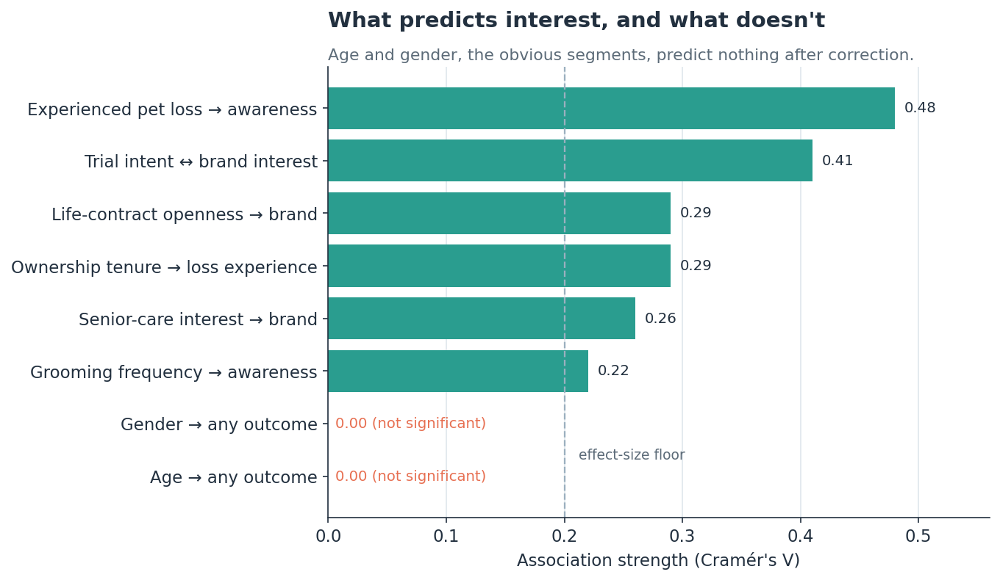

*A quantitative survey analysis for a Taiwan pet-care group weighing an integrated brand (medical, grooming, boarding, and end-of-life under one name): 267 respondents, 276 categorical relationships tested. Client anonymised; data held privately under confidentiality.*

[&larr; Back to portfolio](../)

**Objective:** find who to target for a pre-planned pet-funeral product, and test whether the obvious demographic segments are the right ones to aim at.

## The finding in one line

The obvious way to target a pre-planned pet funeral product is by demographics: age, gender, "urban professional women in their forties." In this data **age and gender predicted nothing**. The real buyer is found through a behavioural chain: owners with 10+ years of tenure are far more likely to have experienced pet loss, which is by far the strongest predictor of knowing the product exists, which leads to a planning mindset, which is what actually predicts intent to buy.

*Cramér's V for each relationship after false-discovery correction. Behavioural signals clear the effect-size floor; age and gender do not register.*

## What this piece demonstrates

- **It refused the obvious segmentation and proved it was empty.** Segmenting by "35 to 45 year old women" feels right and is not evidence-based here. After correcting for multiple comparisons, gender produced zero significant links to any key outcome and age predicted none of them. The piece says so plainly instead of quietly dropping it.
- **It used real statistical discipline, not eyeballed cross-tabs.** 276 categorical pairs tested with Benjamini-Hochberg false-discovery correction and an effect-size floor, so the findings that survive are the ones worth acting on. 221 of the 276 pairs showed nothing, and that is reported as a result, not hidden.
- **It turned the surviving signal into a targeting rule.** Tenure predicts loss experience (the strongest effect in the study), loss experience predicts awareness, awareness predicts a planning mindset, and planning predicts purchase intent. That is a chain, not a coincidence, and it names a warm audience that already sits inside the customer base.

*The chain behind the targeting rule. Long tenure makes pet loss more likely; loss experience is the strongest single predictor of knowing the product exists; awareness leads to a planning mindset, which predicts intent. Cramér's V shown where measured; age and gender attach nowhere on it. Anonymised survey, 267 respondents.*

## The commercial levers it surfaced

- **Grooming is a brand channel, not just a service line.** Grooming frequency is the strongest behavioural predictor of brand awareness, so every salon visit is a brand touchpoint with dual return: retention and awareness.
- **Two "separate" products are one conversion.** Interest in the integrated brand and intent to trial it move together so tightly that a single pitch converts both; running two campaigns wastes one.
- **The price gap has to be met head-on.** Most respondents anchor an acceptable funeral cost well below the NT$16,000 contract. The large undecided middle does not close by leading with "affordable," which only hardens the low anchor. It closes with value framing and instalments.

## Method

A survey instrument covering service behaviour, brand awareness, price expectations, and five business outcomes. Categorical relationships measured with Cramér's V, Likert relationships with an effect-size measure for rank data, every test class corrected for false discovery, and sparse categories collapsed. Findings were kept only if they cleared both significance after correction and a minimum effect size, which is what separates a real pattern from one of 276 coincidences.

## Honest limits

This is a convenience sample skewed toward the group's own audience, 76% female and concentrated in Taipei, so the levels (how many are interested) are not population estimates. The relationships (what predicts what) are the durable part. Outcomes are self-reported intent, which overstates eventual purchase. The value is a disciplined map of which signals to target on and, just as useful, which to stop wasting money on.

**Methods and tools:** survey analysis, Cramér's V association, Benjamini-Hochberg false-discovery correction, effect-size thresholding, Python.

---

*Built by Joey Scully. Product and Commercial Analytics consultant. Available for remote interim and contract work.*
