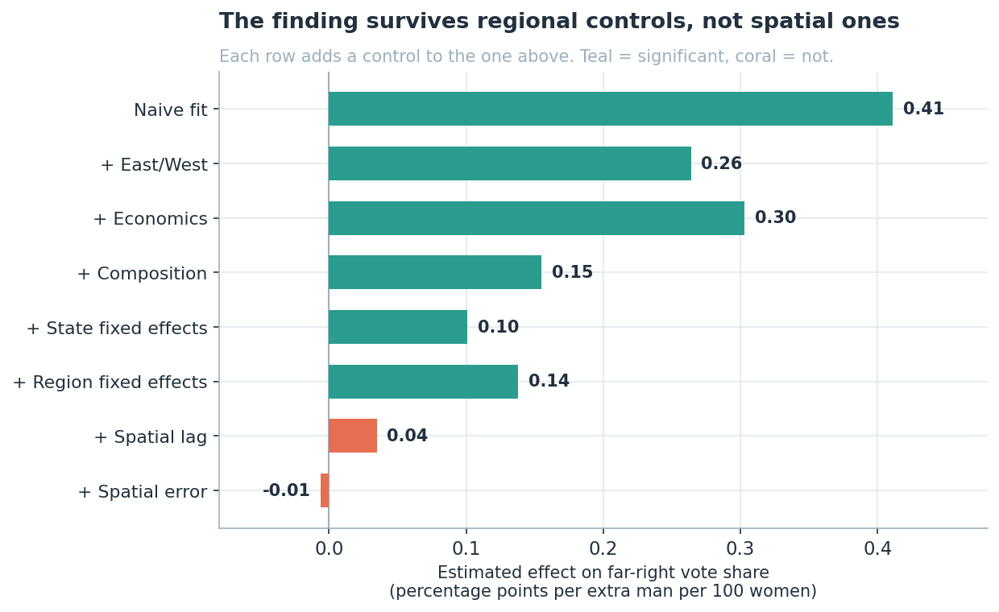
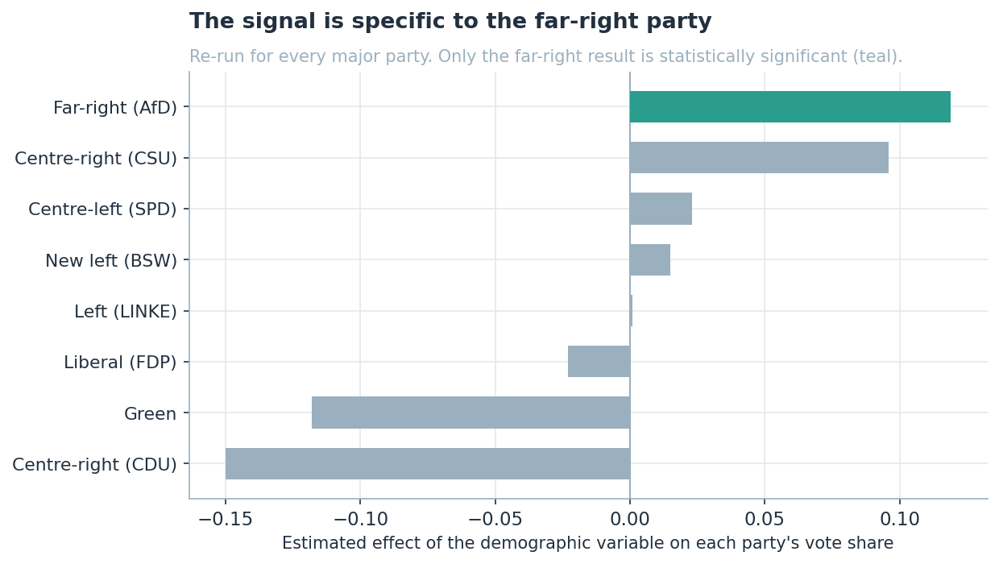

*A self-directed study. Does a region's demographic make-up predict how it votes? Built on public data: official German district population registers and the 2025 federal election results across 397 districts.*

[&larr; Back to portfolio](../)

*The headline variable's estimated effect across the model hierarchy. It holds under state and regional fixed effects and collapses under neighbour-based spatial models. That contradiction is the finding.*

## The finding in one line

A demographic variable (the ratio of young men to young women in a district) predicts a district's far-right vote share. The catch is that whether the effect is real depends entirely on the geographic scale you control for: it survives regional controls at **p = 0.004** and disappears under neighbour-based spatial controls at **p = 0.86**. The honest piece of work is not the significant result. It is deciding which of those two answers to believe, and why.

## What this piece demonstrates

- **It ran the result into the ground before trusting it.** One regression is a headline. This is nine specifications: a naive fit, then layered controls for the east/west divide, for economic conditions, for population composition, then two families of spatial models, then state and regional fixed effects. The point of the ladder was to find the specification that would break the finding.
- **It faced a split verdict instead of hiding it.** The effect is significant under some controls and not others. The easy move is to report the significant models and omit the rest. Instead the split is the subject: the question becomes why a finding would behave that way, and which set of controls actually matches the mechanism being tested.
- **It separated two explanations that look identical in the raw data.** "More men means more male voters" and "a male-heavy area shifts everyone's behaviour" produce the same correlation. A compositional control pulls them apart, and both turn out to be present. That distinction is the whole difference between a trivial result and an interesting one.
- **It checked specificity with placebos.** The signal predicts the far-right party's share and does not predict the mainstream centre-left, centre-right or left parties. A variable that predicted everything would predict nothing.

## The finding, with its edges

The naive correlation is strong: an extra ten men per hundred women is associated with roughly four more percentage points of far-right vote share. Most of that is absorbed once you control for the east/west divide, which carries a large effect of its own (about seventeen points). What is interesting is what is left. After controlling for east/west, for GDP and unemployment, and for the simple share of men in the population, a smaller effect persists (**p = 0.01**). It survives dummies for all sixteen states (**p = 0.027**) and, more stringently, for all thirty-eight statistical regions (**p = 0.004**), meaning it holds even when comparing districts inside the same regional economy.

*The same model run against every major party. The variable predicts the far-right share and nothing else, which is what a real signal should do.*

Then it breaks. Add a spatial lag (each district's vote modelled on its neighbours') and the effect vanishes (**p = 0.39**); a spatial error model kills it outright (**p = 0.86**). Far-right voting clusters very strongly in space (Moran's I = 0.77), so a model that treats all of that clustering as something to remove will remove the signal with it.

The judgment call is which control is appropriate for the mechanism. If the demographic imbalance operates at a regional scale (labour markets and migration span whole regions, not single districts), then state and regional fixed effects are the right test and the effect passes them. If you believe the process is purely local district-to-district contagion, the spatial models are right and the effect is spurious. Both readings are defensible. The contribution is naming the tension precisely rather than claiming a clean win.

## Method

397 districts (Kreise und kreisfreie Städte). Outcome: a party's share of the 2025 federal second vote. Primary variable: men aged 25 to 34 per 100 women of the same age, from official population registers (exact counts, not modelled estimates). Controls: an east/west dummy, GDP per capita, unemployment rate, and overall share of male population. A hierarchy of ordinary least squares models, then state (16) and statistical-region (38) fixed effects, then spatial lag and spatial error models with a contiguity weights matrix. Placebo regressions re-run the specification against every other major party. Spatial structure quantified with Moran's I on both the outcome and the residuals.

## Honest limits

This is cross-sectional: it is an association in one election year, not causal proof, and reverse causation is plausible (an area's politics could drive migration, not only the other way round). The mechanism is inferred, not observed. The effect size is modest. And the central interpretive question (which scale of control to trust) is a judgment, which is exactly why the writeup states both sides rather than one. The value here is the discipline of the robustness ladder and the refusal to report only the flattering half of it.

---

*Built by Joey Scully. Product and Commercial Analytics consultant. Available for remote interim and contract work.*
