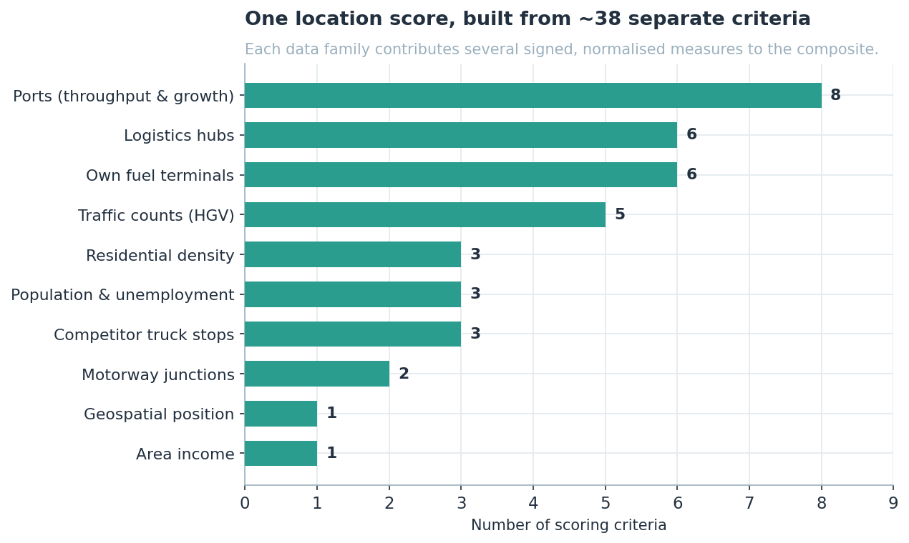
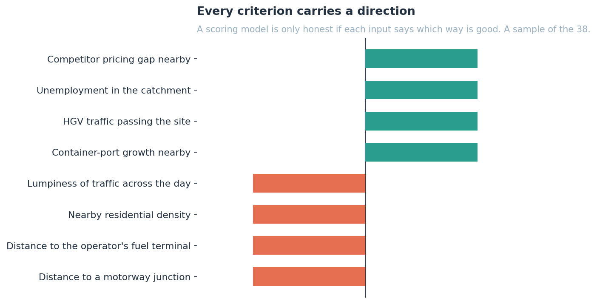

*A decision-science engagement for a European fuel-and-logistics operator, through London Data Unit. Anonymised. Built on public data (port throughput, national traffic counts, census income and population, OpenStreetMap) and licensed truck-stop service data, with OSRM for travel-time catchments.*

[&larr; Back to portfolio](../)

*The model scores each site against roughly 38 criteria drawn from ten data families. Breadth is the point: a good location is good for many separate reasons, and each one is measured on its own terms.*

## The idea in one line

The operator wanted to know which sites in its network, and which competitor and greenfield sites, were the best **locations**, across six countries. Instead of judging by feel or by a single proxy like traffic, the model scores every site against roughly 38 criteria, each tied to a specific commercial reason and given an explicit direction, then combines them into one rankable location score that can be filtered to any region.

## What this piece demonstrates

- **It turns a vague question into measurable, signed criteria.** "Which sites are good?" becomes thirty-eight things you can actually compute, each carrying a commercial rationale and a direction: closer to a growing port is good, closer to housing is bad (planning friction, noise, HGV access), more unemployment in the catchment is good (labour and footfall for a staffed stop). Making the direction explicit is what stops a scoring model from quietly rewarding the wrong thing.
- **It measures catchments, not points.** Market size, competition and labour are measured within a thirty-minute drive of each site using real road-network travel times, not straight-line distance, because a location's value is the market it can actually reach, not its coordinates.
- **It is honest about proxies.** There was no clean dataset for trunking routes, so the presence of named logistics operators at nearby hubs stands in for it. It is labelled a proxy in the model, not dressed up as a direct measure.
- **It states its engineering trade-offs.** One country-scale distance was computed with hex-grid jumps rather than full routing, because the precision that routing buys is not worth the compute at national scale. That is a deliberate, stated choice, not a hidden shortcut.
- **It reframes competition as opportunity.** Competitor service and pricing data is mapped to find "service deserts": places with a provision or pricing gap. A defensive metric (where are my rivals) becomes a commercial one (where could we compete on price or fill a gap).

*A sample of the criteria. Each one is signed so the composite rewards the right direction: growth and traffic count up, distance and housing count down.*

## How the scoring works

Each criterion is computed for every candidate site, normalised to a common scale, and signed as either "more is better" or "closer/less is better". The ten families cover: proximity to ports and the container and roll-on/roll-off throughput there, including multi-year growth; logistics-hub proximity and size; motorway-junction access and whether junctions intersect; heavy-goods traffic in the area by time of day, by vehicle class, and how evenly or unevenly it is spread across the day; income, population and unemployment within the drive-time catchment; proximity to the operator's own fuel terminals by fuel type; competitor truck-stop provision and service pricing; and local residential density at several radii. The signed, normalised criteria are combined into a single composite score, which ranks every site nationally and can be filtered to a region.

## Honest limits

This describes the model and the approach, not the client's ranked output or its criteria weights, which belong to the client. A multi-criteria score is only as defensible as its weights, and weighting is a judgment: the design keeps every criterion transparent and separately inspectable precisely so that weight choices can be argued and tested rather than buried in a single black-box number. Several criteria are proxies, and the model is explicit about which. Some inputs are licensed and cannot be shared. The value here is the discipline of the design: a commercial question made fully computable, at continental scale, without pretending the judgment calls away.

**Methods and tools:** multi-criteria decision analysis, signed-and-normalised scoring, 30-minute OSRM drive-time catchments, H3 hex-grid approximation, proxy design, Python.

---

*Built by Joey Scully. Product and Commercial Analytics consultant. Available for remote interim and contract work.*
