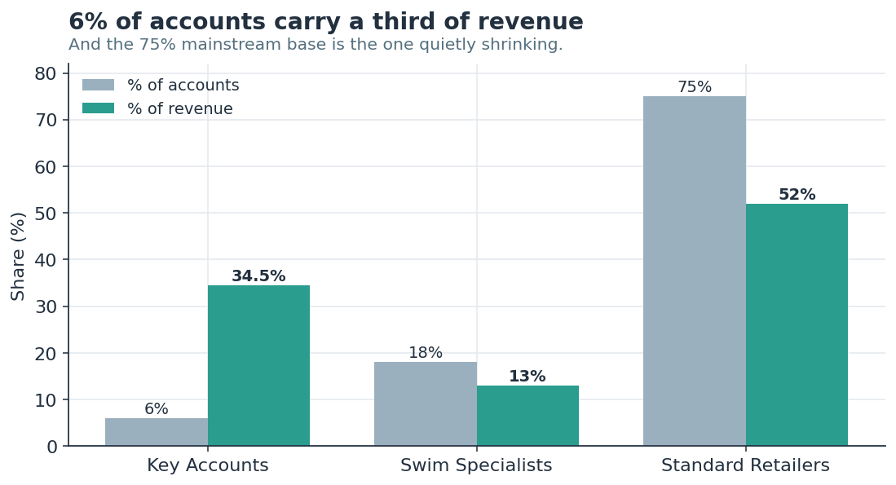
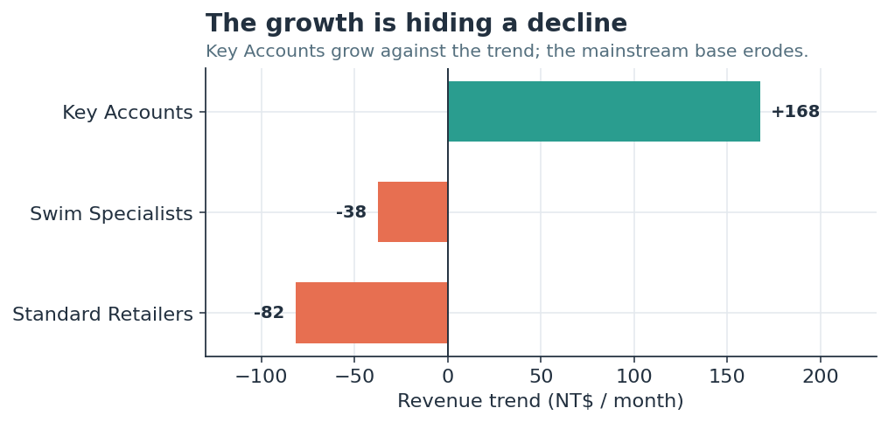

*A customer segmentation of a Taiwan swimwear brand's wholesale channel: 221 retail accounts, 52,778 transactions, March 2023 to August 2026. Client anonymised; data held privately under confidentiality.*

[&larr; Back to portfolio](../)

## The finding in one line

**Twelve accounts, 6% of the customer base, generate 34.5% of wholesale revenue** (TWD 11.2M) and are still growing. Underneath them, the 75% of accounts that make up the mainstream channel are quietly shrinking at a median of **−82 TWD/month**. The business looks healthy in aggregate and is actually two opposite stories stacked on top of each other.

*Key Accounts are 6% of the book and 34.5% of revenue. Standard Retailers are 75% of accounts and the segment in decline.*

## What this piece demonstrates

- **It starts from the commercial question, not the clustering.** The brief was not "segment the customers." It was: which relationships do we protect, where is the money really concentrated, and why does the base feel soft even while the headline grows. The segmentation exists to answer those.
- **The segmentation was validated before it was trusted.** Three clusters from Ward hierarchical clustering, cross-checked against an independent K-Means run. The two agreed at an Adjusted Rand Index of 0.96. The separation is honestly moderate (silhouette 0.32), and I say so rather than dressing it up. Retail behaviour is noisy; the test is whether the groups are stable and act differently, and they are.
- **It ends in decisions, not a chart.** Each of the three segments gets a different operating playbook: account-management tier, pricing approach, assortment focus, and a specific growth action. The analysis is only useful at the point it changes what the sales team does on Monday.

That middle point is the job. Anyone can run a clustering algorithm. The value is knowing which grouping to believe, being straight about how strong it is, and translating it into who gets a dedicated account manager and who moves to self-serve.

## The three segments

| Segment | Accounts | Share of revenue | Revenue trend | The move |
|---|---|---|---|---|
| **Key Accounts** | 12 (6%) | 34.5% | Growing (+168 TWD/mo) | Dedicated account manager, quarterly reviews, first access to launches, tiered volume rebates. Protect and deepen. |
| **Swim Specialists** | 35 (18%) | ~13% | Mild decline | All Taipei, cap-heavy assortment tied to clubs and schools. Pre-summer sell-in, expand the cap range, pilot a club/school programme. |
| **Standard Retailers** | 146 (75%) | 52% | Declining (−82 TWD/mo) | The pressing risk. Triage: protect the top quartile, move the rest to a self-serve catalogue, simplify to hero SKUs, reactivate accounts gone quiet past three months. |

*Monthly revenue trend by segment. The large mainstream base has the most negative trend, which points at category saturation rather than any single lost account.*

The declining mainstream is the headline risk. It is a large, dispersed base of goggle-only accounts with the most negative trend of any segment, which points at category saturation rather than any single lost customer. A brand that only watched its total revenue line would miss it entirely, because the growing Key Accounts are papering over it.

## Method

Eighteen features per customer across five families: economics (net revenue, monthly average, OLS revenue trend, revenue variability, return rate), behaviour (orders per active month, average order value, SKU breadth, recency), category mix (goggles, caps, single lens, other), seasonality (summer skew), and geography (population density, urbanisation, region). Features scaled with a scaler resistant to the large-account outliers, since a handful of distributors are an order of magnitude bigger than the median. Ward hierarchical clustering on the scaled matrix, k chosen by silhouette across k=3,4,5. K-Means at k=3 as an independent stability check (ARI 0.96). UMAP used for visualisation only, never for the clustering itself. Accounts with fewer than three active months were held out and reported separately rather than forced into a group.

## Honest limits

Moderate cluster separation (silhouette 0.32), which is normal for retail behavioural data and the reason the stability check matters more than the raw score. This is one brand's wholesale channel over three and a half years, so the segment shapes are specific to it. Geographic reference values are county-level public statistics, not account-level. It is a description of how the book of business is structured today and what to do about it, which is all it claims to be.

---

*Built by Joey Scully. Product and Commercial Analytics consultant. Available for remote interim and contract work.*
