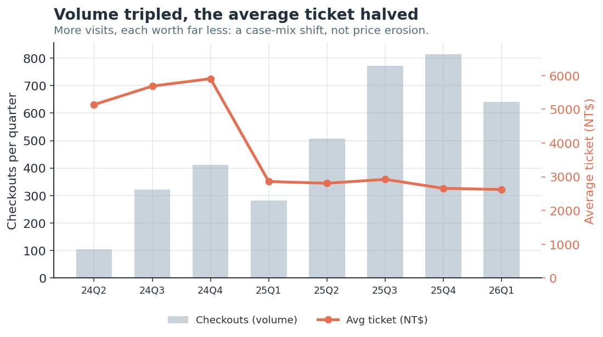
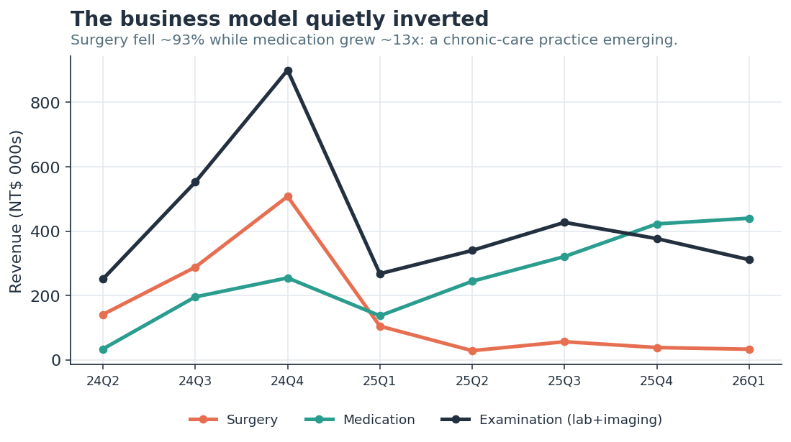

*A business-intelligence study of a Taiwan vet clinic: 14,791 billing line items and 20,589 clinical records, April 2024 to March 2026. Client anonymised; data held privately under confidentiality.*

[&larr; Back to portfolio](../)

**Objective:** explain why a clinic with fast-rising revenue felt financially exposed, and identify what its future actually depends on.

## The finding in one line

The clinic looked like a clear success: visits nearly tripled in 18 months and revenue grew 57% year on year. But the **average ticket had halved**, from about NT$5,500 to NT$2,600. Underneath a healthy top line, the business had quietly stopped being a surgical practice and become a wellness and chronic-care one, and its entire future rested on a cohort-retention bet that no one had written down.

*Checkout volume (bars) against average ticket value (line). Anonymised clinic billing data, 2024Q2 to 2026Q1 (final quarter partial).*

## What this piece demonstrates

- **It read the mechanism of growth, not just the direction.** Revenue up and to the right is where most reporting stops. The composition told the real story: more visits, each worth far less, because the case mix had shifted. A top line can grow for healthy reasons or worrying ones, and the two look identical until you decompose them, which is exactly why a clinic owner watching the revenue line alone felt uneasy without being able to say why.
- **It named a strategic shift the owners were living but had not quantified.** Surgery revenue fell about 93% over five quarters while medication grew roughly 13x. The falling average ticket was a change in what the clinic does, not price erosion. Those are opposite diagnoses with opposite responses: price erosion is a problem to fix, a shift into recurring chronic care is a business to manage, and treating one as the other would push the clinic in precisely the wrong direction.
- **It found the single bet the business depends on.** 82% of patients were enrolled as puppies or kittens, and revenue per patient runs about 2.4x higher once they reach adulthood, yet the prime-adult bracket is currently empty. The clinic's future is almost entirely "do we keep the 2024 puppy cohort as they age," and that reframes what to measure. It is not a clinic with a revenue problem; it is a clinic holding a young cohort whose value has not arrived yet.

*Quarterly revenue by care mode. Surgery fell roughly 93% while medication grew about 13x, the clearest single view of the business-model shift.*

## The risks the numbers expose

- **Revenue is hyper-concentrated.** 6.5% of owners generate 45% of revenue, averaging 23 visits and chronic, complex care. Losing three or four of them is a material event, closer to losing a small anchor tenant than a handful of customers, so they need active relationship management and an early-warning signal on visit cadence rather than being left to churn quietly.
- **Retention leaks at the front door.** 44% of patients visit once and never return, and their visit mix is skewed toward exactly the wellness and health-check visits that should generate a follow-up. That is the cheapest leak to fix in the whole business: these are animals that have already walked in once, so a simple two-week post-first-visit nudge is the obvious lever, and in a business whose future is a retention bet it is also the highest-leverage one.
- **A hidden operational tell.** Tuesday carries 23% of revenue on mid-pack volume, with an average ticket nearly double any other day, which points at specialist and imaging work clustered on one day and a scheduling question worth asking: whether that capacity is deliberately concentrated, and whether it could be spread to smooth both the schedule and the cash flow.

## What it means for the owners

Put together, the three findings point the same way. The clinic is not in trouble, but it is managing the wrong things if it manages revenue. The number that actually decides its future is whether the young 2024 cohort stays through to the adult years when each animal is worth more than twice as much, and the number that most threatens it is the 44% who never come back after a first visit. Both are retention questions, not acquisition ones, which is a different operating posture from the growth story the headline revenue tells. The practical shift is to start reporting cohort retention and young-adult patient counts next to revenue, and to treat the top 6.5% of owners as accounts to be actively held rather than passively served.

## Method

Billing and clinical line items modelled in DuckDB. Revenue decomposed by quarter, service category, and clinical mode to separate volume growth from mix shift, which is the move that turns a flat "revenue is up" into the surgery-to-medication story. Owners were then segmented into value tiers and run through a Pareto concentration analysis to locate where the revenue risk sits. Finally patients were cohorted by first-visit date and by age at enrolment to test the retention-and-ageing thesis, then cross-referenced with breed-level treatment patterns to locate where future chronic-care revenue is most likely to come from.

## Honest limits

One clinic, two years, transactional data only, so it describes what happened rather than why each owner chose it. A large "uncategorised" bucket (health-check packages and adjustments) sits at roughly a third of revenue and blurs the edges of the mode analysis, which the writeup flags rather than smooths over. The ageing-cohort thesis is a forward bet the data frames but cannot yet confirm: the metric to watch is whether the young-adult patient count grows through 2026 and 2027, and the honest position is that the clinic is holding a bet, not sitting on a result.

**Methods and tools:** revenue decomposition (volume versus mix), cohort-retention analysis, value-tier and Pareto concentration, DuckDB, Python.

---

*Built by Joey Scully. Product and Commercial Analytics consultant. Available for remote interim and contract work.*
