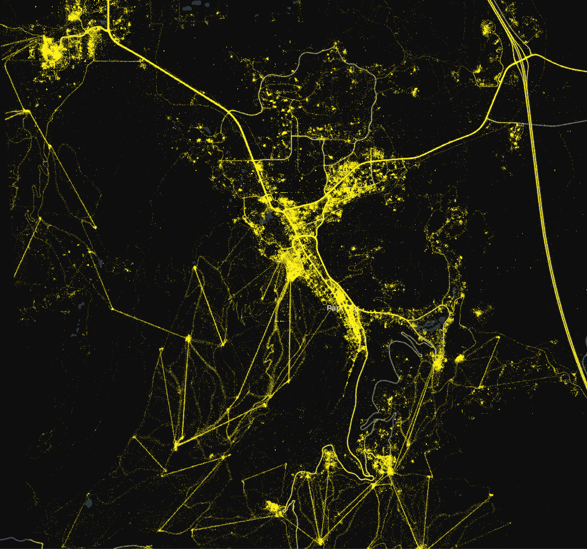
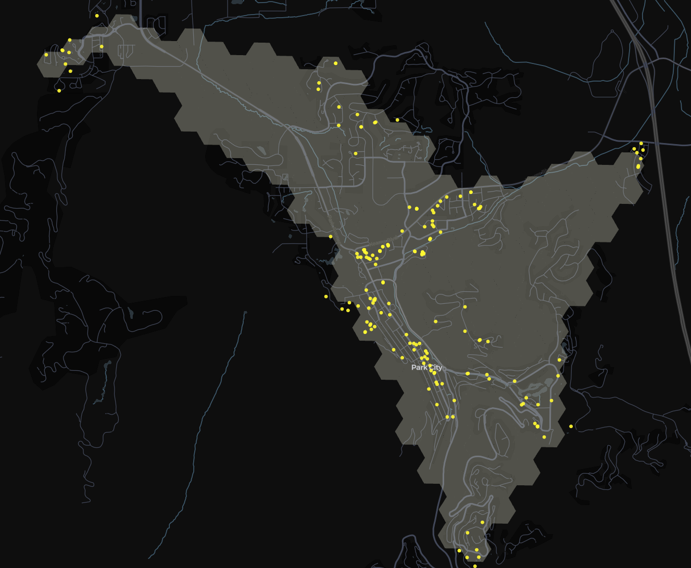

*An independent site-selection project for a US property investor (Woodfine Professional Centres). Built on Google Places, US Census urban areas, LODES employment data, and OpenStreetMap.*

[&larr; Back to portfolio](../)

## The finding in one line

The investment thesis wanted sites where several big-box retailers (a department store, a hardware store, a food distributor) already sit close together, on the logic that they have each solved the same location problem. The usual way to find those is to pile data layers onto a map and hunt by eye. Instead I modelled every candidate store in the country as a node in a graph, connected each to its nearest neighbour of every other type, and extracted the **9,189 "cliques"** where one of each sits mutually closest. Then I made that list tractable, ranking it down to **41 strong candidates**.

*Co-location modelled as a graph. Nodes are stores; edges connect each store to its nearest neighbour of a different class. Clusters of mutually-closest stores are the site candidates.*

## What this piece demonstrates

- **It refused the eyeball-the-map method and said why.** Dropping every layer onto a map and hoping does not scale, does not give you a score, and makes you pick an arbitrary buffer distance that decides the answer for you. The brief literally opened with "what not to do."
- **It reframed the problem into the right shape.** Co-location is a nearest-neighbour question, so it is a graph. Pairwise distances with a decay function become edge weights, and the clusters you want are cliques. That reframing turns an unbounded map-hunt into a finite, rankable set, and it scales to more retailer types without rewriting anything.
- **It made 9,189 candidates decision-ready instead of dumping them.** Each clique was enriched with catchment population, five-year population growth, the area of its bounding footprint, a compactness score (how tightly the stores sit together), and surrounding land-use mix, then ranked by multi-criteria decision analysis. The output was 41 sites worth a human's time, plus a self-serve explorer so the client could interrogate them rather than receive a static list.

*The search was bounded to the 2,644 US Census urban areas, which pre-selects the places worth querying at all.*

## Method

Store locations pulled from the Google Places API, bounded to the 2,644 US Census urban areas so the search space was sensible rather than the whole map. For every pair of retailer types, a pairwise nearest-distance operation, normalised and passed through a distance-decay function so that closer counts for more. Those became the weighted edges of a graph whose nodes are stores. Clique enumeration found every small group of mutually-closest stores, one per type. Each clique was then enriched (catchment population and growth from Census and LODES, bounding area, an isoperimetric compactness score, OpenStreetMap land-use shares) and ranked with multi-criteria decision analysis. A lightweight web explorer let the client filter and inspect the survivors.

## Honest limits

Google Places is convenient and consistent across markets but is not a canonical store registry, so the counts are a sound proof of concept rather than an audited census. OpenStreetMap land-use completeness varies by area. The ranking weights in the decision analysis encode a point of view and should be tuned with the investor, which is exactly what the explorer is for. The value is the method: a repeatable way to turn "find me places that look like this" into a short, scored, defensible shortlist.

---

*Built by Joey Scully. Product and Commercial Analytics consultant. Available for remote interim and contract work.*
