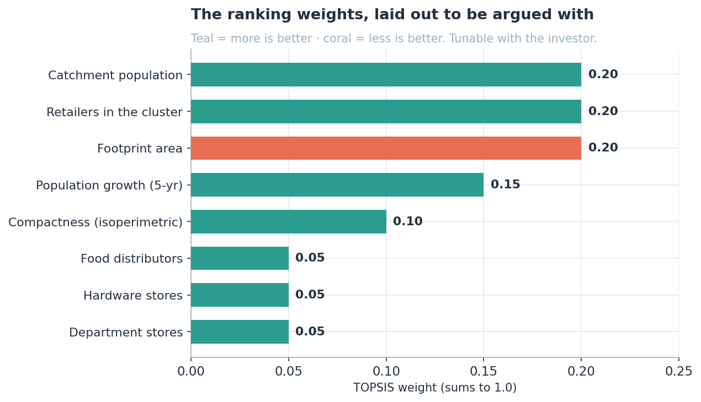

*An independent site-selection project for a US property investor (Woodfine Professional Centres). Built on Google Places, US Census urban areas, LODES employment data, and OpenStreetMap.*

[&larr; Back to portfolio](../)

## The finding in one line

The investment thesis wanted sites where several big-box retailers (a department store, a hardware store, a food distributor) already sit close together, on the logic that they have each solved the same location problem. The usual way to find those is to pile data layers onto a map and hunt by eye. Instead I modelled every candidate store in the country as a node in a graph, connected each to its nearest neighbour of every other type, and extracted the **9,189 "cliques"** where one of each sits mutually closest. Then I made that list tractable, ranking it down to **41 strong candidates**.

*Co-location modelled as a graph. Nodes are stores; edges connect each store to its nearest neighbour of a different class. Clusters of mutually-closest stores are the site candidates.*

## What this piece demonstrates

- **It argued against the method the brief specified.** The client memo asked for intersecting buffers: draw a circle around each store and see what it overlaps. I pushed back, in writing, with reasons. Buffers are binary (a site one metre too far is simply excluded), they force you to treat one retailer type as primary and search outward from it, they carry no information about the shape or tightness of a cluster, they make you pick a radius that quietly decides the answer, and they do not scale once you are comparing thousands of stores across wildly different urban densities. Choosing the harder, better method and defending the choice is the job.
- **It reframed the problem into the right shape.** Co-location is a nearest-neighbour question, so it is a graph. Pairwise distances with a decay function become edge weights, and the clusters you want are cliques. That reframing turns an unbounded map-hunt into a finite, rankable set, and it scales to more retailer types without rewriting anything.
- **It made 9,189 candidates decision-ready instead of dumping them.** Each clique was enriched with catchment population, five-year population growth, the area of its bounding footprint, a compactness score (how tightly the stores sit together), and surrounding land-use mix, then ranked with TOPSIS, a multi-criteria method that scores each candidate by its distance from the best and worst possible site rather than against a pass/fail threshold. Nothing is discarded for narrowly missing a cut-off; everything is ranked. The output was 41 sites worth a human's time, plus a self-serve explorer so the client could interrogate them rather than receive a static list.

*The ranking is transparent by design: every criterion has a weight and a direction, the weights sum to one, and they are meant to be tuned with the investor rather than hidden inside a score.*

*The search was bounded to the 2,644 US Census urban areas, which pre-selects the places worth querying at all.*

## Method

Store locations pulled from the Google Places API, bounded to the 2,644 US Census urban areas so the search space was sensible rather than the whole map. For every pair of retailer types, a pairwise nearest-distance operation, normalised and passed through a distance-decay function so that closer counts for more. Those became the weighted edges of a graph (NetworkX) whose nodes are stores. Clique enumeration found every small group of mutually-closest stores, one per type. Each clique was then enriched (catchment population and growth from Census and LODES, bounding area, an isoperimetric compactness score, OpenStreetMap land-use shares) and ranked with TOPSIS (scikit-criteria). A lightweight web explorer (evidence.dev over a packaged DuckDB database, hosted for a few dollars a month) let the client filter and inspect the survivors, instead of commissioning an expensive GIS tool nobody would maintain.

## The other half: who actually lives there

Finding where retailers cluster answers only half the question. A good co-location is still a bad site if the surrounding population is wrong. So the same engine builds a real catchment for any candidate from anonymous mobility data, rather than drawing a notional circle:

- Each clique's buildings are fenced automatically using **enclosed morphological tessellation**, which cuts the map into street-bounded parcels, so "near this store" means a sensible boundary rather than an arbitrary radius.
- Every device seen inside that fence is traced back through the mobility panel to its likely **home location**, inferred from where it rests on several nights (a demonstration area of 2.2 million position fixes covered roughly 61,000 people over nine days).
- Those home points are reduced to a catchment boundary and mapped to Census block groups, which attach real population, housing and education figures to the site.

The person is never the output; the catchment is. It is the same method lineage as the building-level work elsewhere in this portfolio, pointed at a different commercial question.

## Honest limits

Google Places is convenient and consistent across markets but is not a canonical store registry, so the counts are a sound proof of concept rather than an audited census. OpenStreetMap land-use completeness varies by area. The mobility panel used for catchments is a sample, skewed by who carries which apps, and inferred home locations are probabilistic, so it sizes and shapes a catchment rather than counting it exactly. The ranking weights encode a point of view and should be tuned with the investor, which is exactly what the explorer is for. The value is the method: a repeatable way to turn "find me places that look like this" into a short, scored, defensible shortlist, with the population behind each one attached.

---

*Built by Joey Scully. Product and Commercial Analytics consultant. Available for remote interim and contract work.*
